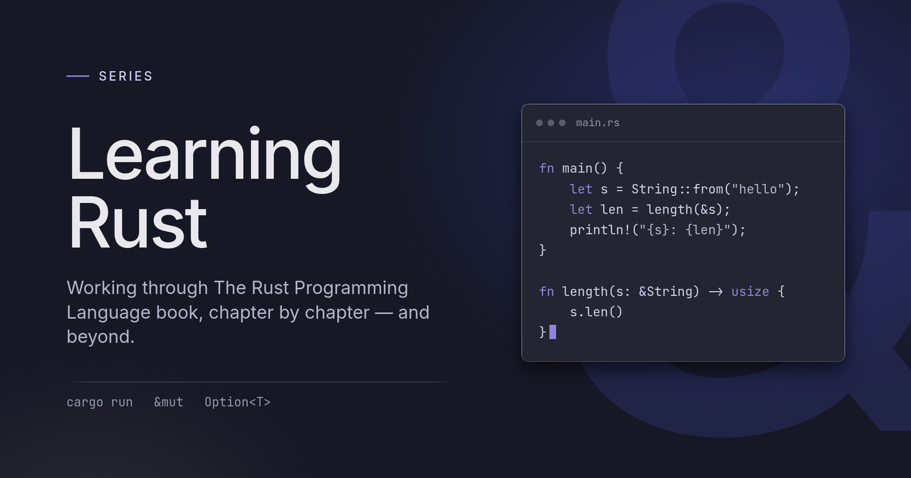

## Intro

When I first started getting interested in Rust, it was admittedly to escape the world of web development, at least a little bit. I was definitely feeling some framework fatigue due to the rapid development of core libraries and frameworks, and this was an era before AI, when software engineers were not exactly used to this type of pressure and rapid change.

I wanted something different, something that would feel a little deeper and more difficult and, ultimately, could fill the gaps that some of my CS studies left open and that web development never forced me to address.

Let me also be extra honest right out of the gate: I was pretty naive. A computer scientist who is too enamored with some parts of their field and completely oblivious to others is not a good computer scientist. As a scientist, you should be enamored with the field and not with just some selected or trendy areas of it. If you ever find yourself with these types of feelings in your career, know that you are just traversing a phase where you are most likely working on something boring, and instead of switching fields entirely, you should seek some deeper knowledge in your current field; that is a much wiser choice.

But, all in all, not all silly endeavours lead to nothingness, and I am glad that one afternoon, YouTube suggested a video by a programmer who was not very well known at the time and who goes by the name of The Primeagen.

The Primeagen's love and enthusiasm for Rust were pervasive and contagious, and it seemed that finally all of my questions were answered: I would learn Rust, escape web development, become a systems engineer and live a happy life!

Ah, youth!

## Why Rust, and not C?

Nonsense! I say both!

In fact, let me say this now so you are warned and well informed: I think learning a bit of C in parallel, or before dipping your toes into Rust, makes a lot of sense!

You see, the best way to understand Rust is to understand the issues the language was invented to address. Whether you, or anybody else, think Rust succeeded in fixing those issues is a different story.

In a nutshell, before Rust, we had two ways of managing memory in computers: the first way is the C way, the manual way. The programmer is responsible for allocating and freeing memory, and failing to do either of these things can lead to catastrophic events. To address this problem, garbage collection software was invented. In programming languages like JavaScript, Python and many others, the language itself (let's not get too specific for now) is equipped with a garbage collection mechanism that makes sure memory is allocated and freed without the need for manual intervention from the developer.

Like anything in life, both options have pros and cons. Managing memory manually means there are no middlemen between you and the bare metal of your machine. Speed is maximum, and generally speaking, performance tends to be better if the programmer knows how to use memory efficiently. With garbage collectors, we are safer, but there is one (several, actually) more step in the way, which slows things down considerably. Memory cannot be managed anymore, so squeezing out performance is a little harder, and your freedom ends where the interpreter begins.

Rust offers a third way: memory can be borrowed, and you can manage it, but to make sure you, the programmer, do not cause the Mars rover to fall into a ditch, the Rust compiler, one of the most impressive things about the language really, will check if your code can run before running it! The compiler becomes the guardian of safety, the ultimate gate through which we are sure our code runs safely, correctly and unequivocally.

You can see how this sounds more than amazing to many people, and I have to say, the vast adoption of Rust in recent years demonstrates that the language can deliver, largely, on this promise.

Things, however, are not so black and white. It is possible, for example, to write extremely safe C code. It has been done many, many times, passing the test of many decades in production. Interpreted languages like JavaScript, even if slower, are still fast enough for the vast majority of cases. Heck, you can even write a decently fast compiler in JavaScript! Also, it is entirely possible, and yes, it has been done already, many times, to write unsafe code in Rust.

So, again, why bother with Rust?

Personally, I like the language. I like the syntax, to a certain extent, and I like the ideas. Yes, Rust is a language full of ideas, and some of them are really, really cool. The compiler is one of, if not the absolute best I have ever encountered. The rigidity of its paradigms makes Rust a teaching ground for forming amazing developers who love correctness and logic above all. The mission to write secure code is of utmost importance, and even though I think it does not relate to Rust in particular and exclusively, it is definitely worth a try.

I am not trying to convince you. Like I said before, we are computer scientists, and getting married to a language is not what we are supposed to do. However, if you, like myself, are curious about this language so full of ideas and promises, and want to see how it works and what it can do for you, that is a very good reason to follow this series!

## Good, so when do we start?

Well, from Lesson 1, of course!

I have recently purchased the 2024 edition of *The Rust Programming Language*, a.k.a. "The Bible (of Rust)", and I cannot wait to see what's new. It's a little less thick than the previous version, which is already quite intriguing, and quite frankly, I intend to use Rust more and more in my development workflow, so getting better at it seems like the right thing to do anyway.

I want to go through the book essentially cover to cover. Yes, it's not necessary to do so for programming books, but I think it's a good way to really know the features of the language, even if you do not end up using them all in your day-to-day work.

There are also tons and tons of good resources online to learn the language, and many more books we could explore, and well, I own them all, so why not have a look if we can!

Ready to go?
