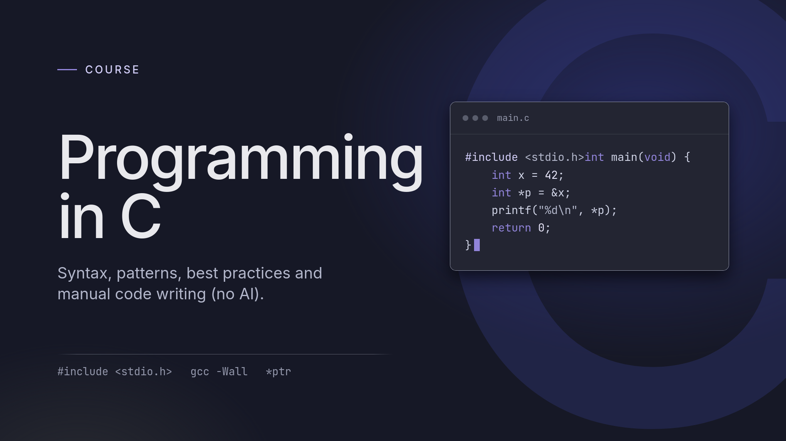

## Let's learn C: Lesson 2

After dipping our toes into the history of C and some of its most prominent features, it's time to get our hands dirty! No better way to do that than writing some code around the most fundamental of concepts: variables.

### Variables: the building blocks

When I first started programming, I was often introduced to the idea that variables are like "buckets" containing data. More often than not, they are labeled buckets, since they usually have names to distinguish them.

I don't think I would be wrong in saying that, in C, this definition falls a little short. It is a useful starting point, but it leaves out the details that matter when we write real programs.

For the variables in this lesson, we can think of each one as a named object with a type and a stored value:

```c
int my_variable = 4;
```

Here, `my_variable` is an integer initialized to the value 4. All good, but as you will soon find out, data in C has many dimensions and nuances. A variable's type affects the values it can hold and the operations we can perform on it.

Its lifetime, however, is a separate question. The local variables in our `main` function have automatic storage duration: they last while that call is running and they do not keep their values for a future call. We will explore other lifetimes later but for now, keep this concept in mind.

C gives us considerable control, but it also has few important rules. Working outside those rules can produce undefined behavior (aka bugs), and the language does not automatically catch every mistake for us.

But let's start with the most straightforward information.

### Variables have types

In C, we must declare variables before we use them. A declaration introduces their names and specifies their types:

```c
int fahr, celsius;
int lower, upper, step;
```

These declarations are valid C. The type tells us what kind of values an object can hold, but its exact size and range depend on the implementation. Do not assume that every machine uses the same representation, because they don't.

Notice that these declarations do not give our variables initial values. Before reading their values, we need to initialize them or assign values to them.

For example, `int` is commonly 32 bits on modern desktop systems, but portable C code cannot rely on that. C11 guarantees that an `int` can represent at least the values from -32767 to 32767. A `float` commonly occupies 32 bits, but that size is not guaranteed either. Range and precision are different properties: range concerns how large or small a value can be, while precision concerns how much detail its representation can retain.

Other basic types in C include:

- `char` - a character type occupying one C byte, so `sizeof(char)` is always 1. A C byte has at least eight bits, but is not required to have exactly eight.
- `short` - a short integer type.
- `long` - a long integer type.
- `double` - a floating-point type with at least as much precision and range as `float`, and usually more.

To check your implementation's actual limits, look in `<limits.h>` and `<float.h>`. Names such as `CHAR_BIT`, `INT_MAX`, and `FLT_DIG` tell us the number of bits in a byte, the largest `int`, and the guaranteed decimal precision of `float`, respectively. We don't need to memorize those limits now, but we do need to know where to find them. The portable requirements are described in the [C11 committee draft, sections 5.2.4.2 and 6.2.5](https://www.open-std.org/JTC1/SC22/WG14/www/docs/n1570.pdf).

Okay, good, but let me get something out of the way: this information may make little sense now, at least in practical terms. However, you can trust me when I tell you it will become very important in your programs moving forward, so learn it well now or come back to brush up anytime you feel something is eluding you. Choosing the right type for the job and knowing its properties are fundamental parts of what makes a good C programmer, well, good.

Key takeaways for now:

- Variables have types.
- Types have ranges and storage requirements; the exact limits depend on the implementation.
- Floating-point range and precision are separate properties.
- Integer arithmetic does not retain fractional results (aka _truncation_).

> [!BONUS] Check your C implementation
>
> Want to see those limits for yourself? You can read the headers directly, or print their definitions from a small C program.
>
> **Read the headers**
>
> These commands open the copies supplied by your GCC installation:
>
> ```sh
> less "$(gcc -print-file-name=include)/limits.h"
> less "$(gcc -print-file-name=include)/float.h"
> ```
>
> Inside `less`, type `/INT_MAX` or `/FLT_DIG` to search, and `q` to quit. Some definitions refer to compiler-provided names, so printing the values is often clearer.
>
> **Print the values**
>
> Save this as `check_limits.c`:
>
> ```c
> #include <stdio.h>
> #include <limits.h>
> #include <float.h>
>
> int main(void) {
>     printf("CHAR_BIT = %d\n", CHAR_BIT);
>     printf("INT_MIN  = %d\n", INT_MIN);
>     printf("INT_MAX  = %d\n", INT_MAX);
>     printf("FLT_DIG  = %d\n", FLT_DIG);
>     printf("DBL_DIG  = %d\n", DBL_DIG);
>     return 0;
> }
> ```
>
> Compile and run it:
>
> ```sh
> gcc -std=c17 -Wall -Wextra -Wpedantic check_limits.c -o check_limits
> ./check_limits
> ```
>
> On the GCC/Linux setup used to check this lesson, the output was:
>
> ```text
> CHAR_BIT = 8
> INT_MIN  = -2147483648
> INT_MAX  = 2147483647
> FLT_DIG  = 6
> DBL_DIG  = 15
> ```
>
> `CHAR_BIT` tells us how many bits are in a byte. `INT_MIN` and `INT_MAX` give the range of `int`. `FLT_DIG` and `DBL_DIG` describe precision in **significant decimal digits** across the whole number. Your implementation's values may differ; that is exactly why we check!
>
> More details: [GNU integer limits](https://sourceware.org/glibc/manual/latest/html_node/Range-of-Type.html) and [floating-point parameters](https://sourceware.org/glibc/manual/latest/html_node/Floating-Point-Parameters.html).

### Format specifiers

Sooner or later, you will want to print the values of your variables, much as you might use `console.log()` in JavaScript. In C, we can use `printf()`.

Here are three conversion specifiers for **`printf`**:

- `%c` - prints a character and expects an `int` argument.
- `%d` - prints a signed decimal integer and expects an `int` argument.
- `%f` - prints a floating-point value and expects a `double` argument.

The first time I have learned about floating points, I have wondered: why does `%f` work when our variable is a `float`? The answer is a neat C feature: the arguments after the format string, C promotes `float` to `double`. Small integer types also undergo integer promotions. These are called the **default argument promotions**.

The function matters. Do not copy these rules directly to `scanf`: there, `%f` expects a pointer to `float`, while `%lf` expects a pointer to `double`. We will deal with input later. The GNU C Library manual explains [output conversions](https://sourceware.org/glibc/manual/latest/html_node/Formatted-Output.html) and [numeric input conversions](https://sourceware.org/glibc/manual/latest/html_node/Numeric-Input-Conversions.html).

There are many more specifiers, and I will leave those for a later lesson. For now, these three will do!

### Statements and expressions

Much like a natural language has grammar, a programming language has rules for combining its parts. C is no exception.
An **expression** can compute a value and can also have side effects, such as changing a variable. For example:

```c
a + b * 2
```

This expression computes a value. Multiplication has higher precedence than addition, so it groups as `a + (b * 2)`. That grouping is not a general guarantee about the order in which operands are evaluated.

An assignment is also an expression:

```c
x = a + b * 2
```

It stores the computed result in `x` and itself has a value: the value assigned to `x`. Adding a semicolon makes this an **expression statement**:

```c
x = a + b * 2;
```

The statement performs the assignment and discards the expression's value. Not every statement ends with a semicolon: a block or a `while` statement with a braced body does not need a trailing one. Declarations are a separate part of C's grammar.

The distinction matters because statements control what our program does, while expressions are how we compute values and perform many of its operations. See the [C11 draft, sections 6.5 and 6.8](https://www.open-std.org/JTC1/SC22/WG14/www/docs/n1570.pdf), for the language rules.

Equipped with this knowledge, let's jump into writing our second C program, after the Hello World example in the first lesson.

### Let's write a program: temperature converter

The K&R book moves quickly into a program that converts temperatures from Fahrenheit to Celsius. I will follow the same example because it is a great way to get our feet wet with variables, statements, expressions, and format specifiers. It also introduces some basic practices for organizing C code.

Here is our first attempt, available in the repository as `f_to_c_V1.c`:

```c
#include <stdio.h>

/* Print a Fahrenheit-Celsius table
 * for fahr = 0, 20, ..., 300.
 */
int main(void) {
  int fahr, celsius;
  int lower, upper, step;

  lower = 0;
  upper = 300;
  step = 20;

  fahr = lower;
  while (fahr <= upper) {
    celsius = 5 * (fahr - 32) / 9;
    printf("%d\t%d\n", fahr, celsius);
    fahr = fahr + step;
  }
}
```

Let's comment the code to make sure we know what is happening:

```c
// Include the standard input/output header, which declares printf.
#include <stdio.h>

// main returns int; void means that it has no parameters.
int main(void) {
  int fahr, celsius;      // Declare two integer variables.
  int lower, upper, step; // Declare three more integer variables.

  lower = 0;   // Assign the lower temperature limit.
  upper = 300; // Assign the upper temperature limit.
  step = 20;   // Assign the increment between rows.

  fahr = lower;
  // Loop while fahr is less than or equal to upper.
  while (fahr <= upper) {
    // Compute the conversion with integer arithmetic.
    // Multiply before dividing; integer 5 / 9 would be zero.
    celsius = 5 * (fahr - 32) / 9;
    // Print both integers, a horizontal tab, and a newline.
    printf("%d\t%d\n", fahr, celsius);
    // Advance to the next Fahrenheit value.
    fahr = fahr + step;
  }
  return 0;
}
```

A few details deserve special attention:

- `#include <stdio.h>` includes a header containing declarations, types, and macros for standard input/output. It does not include the entire standard library, as you may be tempted to assume coming from other languages.
- In `int main(void)`, `(void)` means **no parameters**. We will write it explicitly in this course, as it is considered a best practice and I have often verified that in large C repositories.
- `lower = 0;` is an assignment after a declaration. `int lower = 0;` would be a declaration with an initializer.
- Since C99, integer division truncates toward zero. At 0 degrees Fahrenheit, this expression gives -17, not -18.
- `\t` is a horizontal tab, not a table character. Its visual spacing depends on the terminal.
- In C99 and later, reaching the end of `main` returns 0. We could also write `return 0;` explicitly, as in Lesson 1.

There is a lot going on in these few lines, but hopefully nothing too complicated. Take your time to digest it, and don't get too worried if you don't get it all at once. If you are serious about learning C, you cannot escape these concepts, so you will have time to sharpen them. Knowing they exist is just about the best weapon in your arsenal right now.

From the repository's `lesson_2` directory, compile and run the program with warnings enabled and an explicit C standard:

```sh
gcc -std=c17 -Wall -Wextra -Wpedantic f_to_c_V1.c -o f_to_c_V1
./f_to_c_V1
```

When you run it, the output is:

```text
0	-17
20	-6
40	4
60	15
80	26
100	37
120	48
140	60
160	71
180	82
200	93
220	104
240	115
260	126
280	137
300	148
```

I know, what the heck are those:

```
-std=c17 -Wall -Wextra -Wpedantic
```

In the real world, C programmers use the compiler to their advantage, and the C compiler is so so good and powerful. Those flags are among the ones you will see often, and I want to write an article to dive deep into them, so for now, know that:

> [!BONUS] What do those compiler flags do?
>
> They tell GCC **which C version to use** and **which warnings to enable**.
>
> | Flag         | What it does                                                                                                                                                     |
> | ------------ | ---------------------------------------------------------------------------------------------------------------------------------------------------------------- |
> | `-std=c17`   | Selects the C17 language standard, making the compiler mode explicit.                                                                                            |
> | `-Wall`      | Enables a broad group of common warnings, such as unused variables and incorrect `printf` format specifiers. Despite its name, it does not enable every warning. |
> | `-Wextra`    | Adds further warning checks. Combined with `-Wall`, it can warn about unused function parameters, for example.                                                   |
> | `-Wpedantic` | Reports certain violations of the selected ISO C standard, including uses of compiler extensions. Here, it checks against C17.                                   |
>
> For example, if `celsius` is a `float`, this line has a format mismatch:
>
> ```c
> printf("%d\n", celsius);
> ```
>
> With `-Wall`, GCC warns that `%d` expects an `int`, while the argument is passed as a `double` after promotion.
>
> Warnings normally allow compilation to continue. Read them anyway: the compiler may have spotted something you missed!
>
> GCC explains these options in its [language-standard documentation](https://gcc.gnu.org/onlinedocs/gcc/C-Dialect-Options.html) and [warning-options documentation](https://gcc.gnu.org/onlinedocs/gcc/Warning-Options.html).

The results follow our integer arithmetic, but there is a problem, well, two:

1. we have discarded the fractional part. For example, 0 degrees Fahrenheit is approximately -17.8 degrees Celsius, while our program prints -17.
2. the output is actually quite ugly from a purely aesthetic point of view.

Remember when I said that types might not make much sense in the abstract, but would be important in practice? Well, this is it. A type that is unsuitable for the job can produce results that are too coarse for our needs, and case in point, it just happened.

To fix the imprecision bug, we should switch to floating-point arithmetic. In other words, we should change the type from `int` to `float`.
Let's make that choice clear in the calculation too.

Here is a version that prints six digits after the decimal point:

```c
#include <stdio.h>

int main(void) {
  float fahr, celsius;
  float lower, upper, step;

  lower = 0;
  upper = 300;
  step = 20;

  fahr = lower;
  while (fahr <= upper) {
    celsius = 5.0f * (fahr - 32.0f) / 9.0f;
    printf("%f\t%f\n", fahr, celsius);
    fahr = fahr + step;
  }
  return 0;
}
```

The `f` suffix makes those constants `float` values. The repository's version, `5 * (fahr - 32) / 9`, also works here because `fahr` is a `float` and the integer operands are converted for the arithmetic. To be honest, you should be explicit when you can. I think `5.0f` is a much better practice than what I wrote in the source, and I wanted to live it there to show you that yes, can work, but I would myself flag that in a code review. So, be explicit when you can, always.

On top of that, you should not let the destination type fool you: assigning an integer calculation to a `float` cannot recover a fraction already discarded by integer division. In `5 / 9 * (fahr - 32)`, the `5 / 9` part is still integer arithmetic and because of _truncation_ gives zero. All good intentions, but the fraction is already gone!

Here is an example of the six-decimal output from GCC on the Linux setup used to check this lesson. The last few digits can vary with the floating-point implementation:

```text
0.000000	-17.777779
20.000000	-6.666667
40.000000	4.444445
60.000000	15.555555
80.000000	26.666666
100.000000	37.777779
120.000000	48.888889
140.000000	60.000000
160.000000	71.111115
180.000000	82.222221
200.000000	93.333336
220.000000	104.444443
240.000000	115.555557
260.000000	126.666664
280.000000	137.777771
300.000000	148.888885
```

> [!CLARIFICATION] Floating-point precision
>
> To be noted: floating-point values are still approximations. Printing six decimal places does not guarantee six accurate decimal places, and printing fewer places does not change the stored result.

I am a picky programmer, and all those zeroes and long numbers are not how I want a temperature indicator to look. Let's improve the display by adjusting the format string:

```c
printf("%3.0fF\t%6.1fC\n", fahr, celsius);
```

The `3` and `6` are called **minimum field widths**, including any sign and decimal point. `.0` prints no digits after the decimal point, while `.1` prints one. `F` and `C` are literal unit labels (aka letters). A value that needs more space is not cut off. The [GNU C Library's conversion syntax](https://sourceware.org/glibc/manual/latest/html_node/Output-Conversion-Syntax.html) explains these options so worth reading and checking out more.

The repository's `f_to_c_V2.c` already formats the numbers as `%3.0f\t%6.1f`, without unit labels. I suggest you go ahead and change that line in your copy to the version above, and rebuild it:

```sh
gcc -std=c17 -Wall -Wextra -Wpedantic f_to_c_V2.c -o f_to_c_V2
./f_to_c_V2
```

Now we get a cleaner display, rounded to one decimal place for Celsius:

```text
  0F	 -17.8C
 20F	  -6.7C
 40F	   4.4C
 60F	  15.6C
 80F	  26.7C
100F	  37.8C
120F	  48.9C
140F	  60.0C
160F	  71.1C
180F	  82.2C
200F	  93.3C
220F	 104.4C
240F	 115.6C
260F	 126.7C
280F	 137.8C
300F	 148.9C
```

> [!EXERCISE] 1 - Make it work, but then make it pretty!
>
> Let's print a header before the table, to make it look more like a complete program.
>
> 1. Write an ASCII header before the table. Use your own taste, but make it pretty!
> 2. Include your name. You are, after all, the programmer who made this awesome temperature converter!
> 3. Check how I did it in the source code. If you manage to surpass the immense beauty of my solution, suggest an improvement on GitHub!

> [!EXERCISE] 2 - Let's make things interesting!
>
> You now know how to write a converter from Fahrenheit to Celsius. What if we wanted to do the opposite? Many countries use Celsius, so the reverse conversion could come in handy too!
>
> 1. Write a Celsius-to-Fahrenheit converter.
> 2. Research the conversion formula and make the necessary changes to your code. Check your result with known values, such as 0 degrees Celsius equaling 32 degrees Fahrenheit.
> 3. Try not to use AI! Search, think, experiment, and, as a last resort, check `c_to_f.c` or `exercises/exercise_1_V2.c` in my repository for one possible solution.

### What did we learn?

In this lesson, we experienced firsthand why choosing suitable types for our variables matters. We also saw how `printf()` format strings change the display of those values, and how arithmetic operators group an expression through precedence and associativity.

We learned to declare variables, initialize them or assign values later, reassign them, and distinguish expressions from statements. We also saw the difference between discarding fractions through integer division and rounding floating-point values for display.

In the next chapter, we'll talk about functions. I can't wait!

> [!SOURCES]
>
> **Sources**
>
> - Brian W. Kernighan and Dennis M. Ritchie, _The C Programming Language_, second edition, Chapter 1 - the course's starting point and temperature-converter example.
> - [WG14 C11 committee draft, N1570](https://www.open-std.org/JTC1/SC22/WG14/www/docs/n1570.pdf) - type limits, storage duration, promotions, expressions, statements, `main`, and formatted output. Relevant sections: 5.1.2.2, 5.2.4.2, 6.2.4, 6.3.1, 6.5, 6.7.9, 6.8, and 7.21.6.1.
> - [GNU C Library - formatted output](https://sourceware.org/glibc/manual/latest/html_node/Formatted-Output.html) - `printf` and its conversion specifiers.
>
> **Resources for practice**
>
> - [GNU C Library - floating-point conversions](https://sourceware.org/glibc/manual/latest/html_node/Floating_002dPoint-Conversions.html) - field widths, precision, and floating-point display.
> - [GCC - C dialect options](https://gcc.gnu.org/onlinedocs/gcc/C-Dialect-Options.html) - selecting a C standard explicitly.
> - [GCC - warning options](https://gcc.gnu.org/onlinedocs/gcc/Warning-Options.html) - compiler checks to use while experimenting.
> - [Lesson 2 code and exercises](https://github.com/Memnoc/C_course/tree/main/lesson_2) - compile, change one thing, and compare the output.
